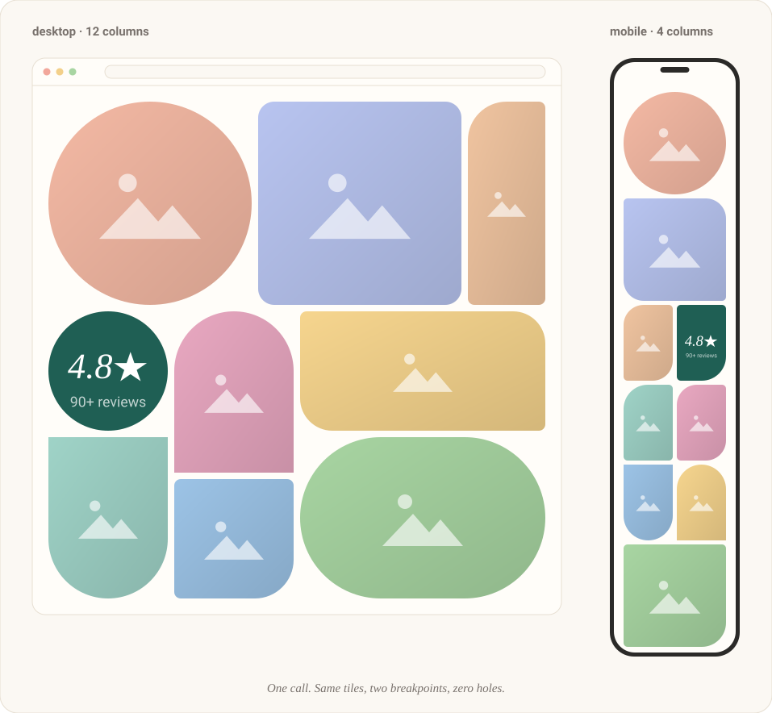
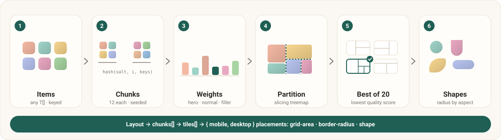
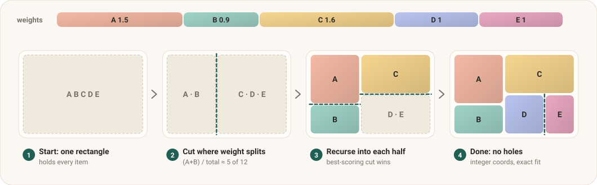
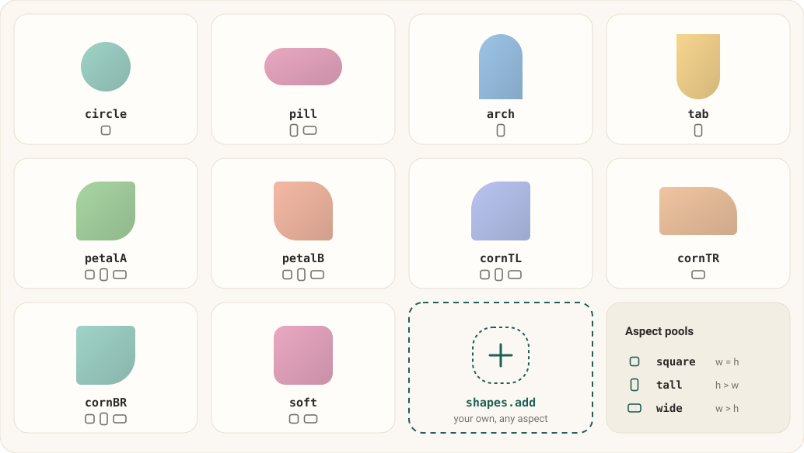
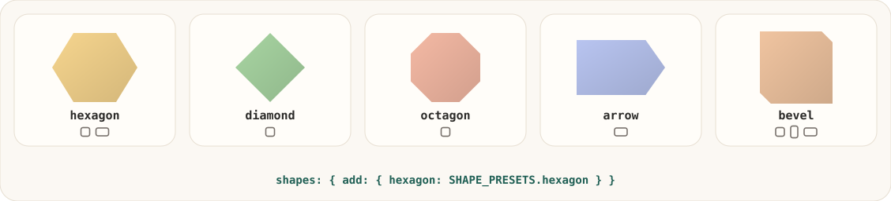
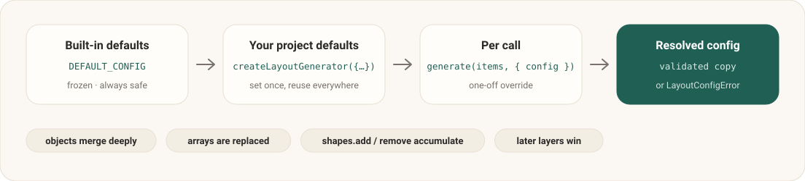
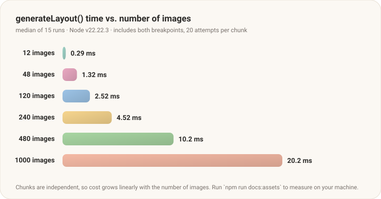

<div align="center">

# bentoloom

**Seeded, gapless bento layouts for image galleries.**
Irregular shapes, decorative filler tiles, mobile + desktop grids, zero dependencies.

[](https://www.npmjs.com/package/bentoloom)
[](https://npm-stat.com/charts.html?package=bentoloom)
[](https://bundlephobia.com/package/bentoloom)
[](https://packagephobia.com/result?p=bentoloom)
[](#api)
[](https://www.npmjs.com/package/bentoloom?activeTab=dependencies)
[](https://github.com/Traam0/bentoloom/actions/workflows/ci.yml)
[](./LICENSE)



<sub>That image is real output: it was rendered from `generateLayout()` itself.</sub>

</div>

---

## Why

Uniform grids look generic, and hand-placed bento grids don't scale past a dozen photos. **bentoloom** generates the layout for you:

- **Gapless.** Every cell is covered exactly once, with no holes or overlaps. This is enforced by a property test, not by hope.
- **Deterministic.** Same input, same salt and same version give the same layout. It is SSR and hydration safe, and `salt` rerolls everything.
- **Two breakpoints.** Every tile has a mobile and a desktop placement, solved independently.
- **Personality.** Ten irregular `border-radius` shapes (arches, petals, pills, circles, and more), opt-in **`clip-path`** shapes (hexagons, diamonds, your own `polygon()`/`path()`), plus filler tiles like ratings, pulse lines and paws.
- **Yours to configure.** Every default can be overridden, and you can extend the shape pool with your own.
- **Tiny and boring.** Zero dependencies, about 3.3 kB min+gzip, ESM and CJS, full types, `sideEffects: false`.
- **Framework-agnostic.** The engine returns plain data and CSS values. Use it with React, Vue, Svelte, or plain HTML.

## Install

```bash
npm i bentoloom
# pnpm add bentoloom · yarn add bentoloom · bun add bentoloom
```

## Quick start

```ts
import { generateLayout } from "bentoloom";

const images = [
  { file: "gallery/cat.jpg", alt: "A cat", caption: "Resting after a check-up" },
  // ...any number of items, any shape of object
];

const layout = generateLayout(images, { config: { salt: "my-site" } });
```

`layout.chunks[].tiles[]` is what you render:

```ts
{
  kind: "item",                 // or "filler"
  item: { file, alt, caption }, // your original object, untouched
  index: 0,                     // reading order (for lightboxes)
  mobile:  { area: "1 / 1 / 4 / 4",  radius: "9999px", clipPath: "none", shape: "circle", x, y, w, h },
  desktop: { area: "1 / 1 / 5 / 5",  radius: "6rem 1rem 1rem 1rem", clipPath: "none", shape: "cornTL", x, y, w, h },
}
```

### Render it (React + Tailwind)

```tsx
import { generateLayout, tileCssVars, chunkCssVars } from "bentoloom";

const layout = generateLayout(IMAGES, { config: { salt: "some-salt-or-seed" } });

export function Gallery() {
  return (
    <div className="@container space-y-3 lg:space-y-4">
      {layout.chunks.map((chunk) => (
        <div
          key={chunk.id}
          style={chunkCssVars(chunk)}
          className="grid grid-cols-4 gap-3 [--u:calc((100cqw-2.25rem)/4)] grid-rows-[repeat(var(--rm),var(--u))]
                     lg:grid-cols-12 lg:gap-4 lg:[--u:calc((100cqw-11rem)/12)] lg:grid-rows-[repeat(var(--rd),var(--u))]"
        >
          {chunk.tiles.map((t) => (
            <div
              key={t.kind === "item" ? t.index : `${chunk.id}-${t.filler}`}
              style={tileCssVars(t)}
              className="[grid-area:var(--gm)] [border-radius:var(--brm)] [clip-path:var(--cpm)] lg:[grid-area:var(--gd)] lg:[border-radius:var(--brd)] lg:[clip-path:var(--cpd)] overflow-hidden"
            >
              {t.kind === "item" ?  : <Filler kind={t.filler} />}
            </div>
          ))}
        </div>
      ))}
    </div>
  );
}
```

### Render it (plain CSS)

The grid uses square cells (`--u`), so the wrapper must be a size container:

```css
.bento-wrap { container-type: inline-size; }
.bento {
  display: grid; gap: .75rem;
  grid-template-columns: repeat(4, 1fr);
  --u: calc((100cqw - 2.25rem) / 4);                 /* (width - gaps) / cols */
  grid-template-rows: repeat(var(--rm), var(--u));
}
.bento > * { grid-area: var(--gm); border-radius: var(--brm); clip-path: var(--cpm); overflow: hidden; }

@media (min-width: 1024px) {
  .bento {
    gap: 1rem;
    grid-template-columns: repeat(12, 1fr);
    --u: calc((100cqw - 11rem) / 12);
    grid-template-rows: repeat(var(--rd), var(--u));
  }
  .bento > * { grid-area: var(--gd); border-radius: var(--brd); clip-path: var(--cpd); }
}
```

> Keep the column counts and gaps in sync with `config.grid.*.cols`. If you change the grid, update the CSS to match.

## How it works



1. **Items.** Anything goes. Each item is identified by a *key* (`id | key | src | file | url`, or `getKey`).
2. **Chunks.** Items are split into groups of 12 (a tiny tail merges into the previous group). Each chunk is its own grid, and its **seed** is `hash(salt, chunkIndex, keys)`.
3. **Weights.** Each slot gets a relative size from a seeded RNG: 15% become *heroes*, the rest are normal, and one filler is inserted at a random inner position.
4. **Partition.** A slicing treemap cuts the grid recursively (see below), once per breakpoint.
5. **Best of 20.** Twenty randomized partitions are generated, and the one with the best `quality` score wins (squarer tiles, areas close to their weight). If every attempt fails, a plain hole-free row layout is used.
6. **Shapes.** Each tile's aspect (square, tall or wide) selects a pool, and a shape is picked from it, avoiding repeats.

### The partition step



For items `[lo, hi)` in a rectangle, the algorithm tries every split point and both orientations. The cut lands at the weight-proportional position, rounded to an integer. Candidates are rejected if a side is smaller than `minSide` or an area smaller than `minArea`. The rest are scored on aspect ratio, rounding drift and a little seeded jitter, and the top four are tried with backtracking.

Because every cut is a *guillotine cut on integer coordinates*, the result can never contain holes or overlaps. That is why `grid-area` values always fit exactly.

## Shapes



Each aspect has a **pool** of shape names, and `radii` maps a name to a CSS `border-radius`. Extend or trim them at any layer:

```ts
import { createLayoutGenerator } from "bentoloom";

export const gallery = createLayoutGenerator({
  shapes: {
    // register a shape and add it to every pool (or only some aspects)
    add: {
      blob:  { radius: "30% 70% 70% 30% / 30% 30% 70% 70%", aspects: ["square"] },
      ticket: { radius: "1rem 3rem 1rem 3rem" },
    },
    remove: ["circle"],              // drop names from all pools
  },
});
```

### Clip-path shapes

A shape can carry a CSS `clip-path` instead of (or on top of) a `border-radius`, which unlocks hexagons, diamonds, arrows and anything `polygon()`, `circle()`, `inset()` or `path()` can draw.



```ts
import { createLayoutGenerator, SHAPE_PRESETS } from "bentoloom";

export const gallery = createLayoutGenerator({
  shapes: {
    add: {
      hexagon: SHAPE_PRESETS.hexagon,                       // ready-made, opt-in
      zigzag: {                                             // your own
        clipPath: "polygon(0 0, 100% 0, 100% 85%, 75% 100%, 50% 85%, 25% 100%, 0 85%)",
        aspects: ["square", "wide"],
      },
      stamp: { radius: "1rem", clipPath: "inset(0 round 1rem)" }, // both are allowed
    },
  },
});
```

Presets: `hexagon`, `diamond`, `octagon`, `arrow`, `bevel`. They are **not** in the default pools, so existing layouts do not change until you add them. Percentage-based clips scale with the tile, so use `aspects` to keep a shape on tiles where it looks right (a diamond wants a square, an arrow wants a wide tile).

Each placement gets `clipPath` (`"none"` when the shape has none), and `radius` is `"0"` for clip-only shapes, so the CSS variables `--cpm` / `--cpd` are always valid values. Things to know:

- `clip-path` also clips focus rings, outlines and `box-shadow`. Put a shadow on a wrapper with `filter: drop-shadow()`, or keep clickable tiles on radius shapes.
- Hover zoom on the image inside still works; the clip is applied to the tile.
- `shapes.clips` is the raw name → clip-path map (merged like `radii`), and `shapes.add` is the shortcut that fills `radii`, `clips` and the pools in one go.

Need full control? Replace pools outright: `shapes: { radii: { only: "12px" }, pools: { square: ["only"], tall: ["only"], wide: ["only"] } }`.

## Configuration



```ts
import { createLayoutGenerator, generateLayout, DEFAULT_CONFIG } from "bentoloom";

// 1. project-wide defaults, set once
export const gallery = createLayoutGenerator({
  salt: "some-salt-or-seed",
  chunkSize: 10,
  heroChance: 0.25,
  fillers: ["stat", "paw"],                       // [] disables fillers
  grid: { desktop: { cols: 12, cellsPerWeight: 12 } },
});

// 2. per-call overrides
gallery.generate(images, { config: { salt: "homepage" } });

// extending an array default: spread it
createLayoutGenerator({ fillers: [...DEFAULT_CONFIG.fillers, "logo"] });
```

Invalid config throws a `LayoutConfigError` listing every problem at once.

| Option | Default | Meaning |
| --- | --- | --- |
| `salt` | `""` | Change it to reroll every layout |
| `chunkSize` | `12` | Items per independent grid |
| `minTail` | `4` | A smaller last chunk merges into the previous one |
| `attempts` | `20` | Candidate partitions per chunk and breakpoint |
| `heroChance` | `0.15` | Chance an item becomes a large tile (0–1) |
| `weights.hero` | `[2.1, 2.7]` | Relative size range of heroes |
| `weights.normal` | `[0.8, 1.6]` | Relative size range of normal tiles |
| `weights.filler` | `0.8` | Relative size of fillers |
| `fillers` | `["stat","pulse","paw"]` | Filler kinds, cycled per chunk (`[]` = none) |
| `fillersPerChunk` | `1` | Fillers per chunk (max one per 3 items) |
| `grid.desktop` | `cols 12 · cellsPerWeight 10 · minSide 2 · minArea 6` | Desktop grid (+ `fallbackPerRow 3`, `fallbackRowHeight 4`) |
| `grid.mobile` | `cols 4 · cellsPerWeight 6 · minSide 2 · minArea 4` | Mobile grid (+ `fallbackPerRow 2`, `fallbackRowHeight 3`) |
| `shapes.radii` | 10 built-ins | Shape name → CSS `border-radius` |
| `shapes.clips` | `{}` | Shape name → CSS `clip-path` (see `SHAPE_PRESETS`) |
| `shapes.pools` | per aspect | Names allowed for `square`, `tall`, `wide` |

**Merge rules:** objects merge deeply, arrays and primitives are replaced, `undefined` is ignored, and `shapes.add` / `shapes.remove` accumulate across layers. Larger `cellsPerWeight` means bigger tiles and a taller page.

## API

| Export | Description |
| --- | --- |
| `generateLayout(items, { config?, getKey? })` | One-shot layout using built-in defaults plus `config` |
| `createLayoutGenerator(defaults?)` | Returns `{ config, generate(items, options?) }` with your defaults baked in |
| `resolveConfig(patch?, base?)` | Layer, validate and return a fresh `LayoutConfig` |
| `DEFAULT_CONFIG` | The frozen built-in defaults |
| `tileCssVars(tile)` | `{ --gm, --gd, --brm, --brd, --cpm, --cpd }` for a tile (grid-area, radius, clip-path per breakpoint) |
| `SHAPE_PRESETS` | Frozen, opt-in clip-path shapes: `hexagon`, `diamond`, `octagon`, `arrow`, `bevel` |
| `chunkCssVars(chunk)` | `{ --rm, --rd }` (row counts) for a chunk |
| `LayoutConfigError` | Thrown for invalid config, with `.problems: string[]` |

Types: `Layout`, `Chunk`, `Tile`, `Placement`, `LayoutConfig`, `UserConfig`, `GridConfig`, `ShapesConfig`, `ShapesInput`, `ShapeDef`, `ShapePresetName`, `GenerateOptions`, `Aspect`.

### What can I pass as items?

Anything. `generateLayout<T>(items: readonly T[])` never reads your objects beyond the seed key, and `tile.item` is the same reference you passed in. If your objects have no `id/key/src/file/url`, pass `getKey: (x) => x.slug`.

## Determinism and stability

The same items, config and version produce the same layout. The golden-snapshot test locks this down, so **a change to layout output is a breaking change** and gets a major version bump. Reorder or change an item's key, or change the salt, and the layout changes; that is the intended way to reroll.

## Performance



Chunks are independent, so cost grows linearly. A thousand images lay out in a few tens of milliseconds on a laptop-class machine, which is cheap enough for build time or a server component. The chart is generated by `npm run docs:assets` on whatever machine runs it, so your numbers will differ.

## Package stats

Live stats appear once the package is published:

- Downloads: [npm-stat.com](https://npm-stat.com/charts.html?package=bentoloom) · [npmjs.com](https://www.npmjs.com/package/bentoloom)
- Size: [bundlephobia](https://bundlephobia.com/package/bentoloom) · [packagephobia](https://packagephobia.com/result?p=bentoloom)

[](https://star-history.com/#Traam0/bentoloom&Date)

## Contributing

```bash
npm install
npm test               # 99 tests
npm run coverage       # enforced thresholds
npm run build          # ESM + CJS + .d.ts
npm run check:package  # publint + are-the-types-wrong
npm run docs:assets    # regenerate the README illustrations from the real build
```

The dev tooling (vitest 5) needs Node 22.12+; the published package itself supports Node 18+.

Releasing: bump the version and `CHANGELOG.md`, tag `vX.Y.Z`, push the tag. The release workflow publishes to npm and uses the matching changelog section as the release notes.

## License

[MIT](./LICENSE)
